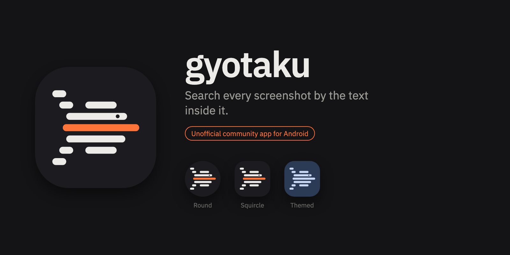
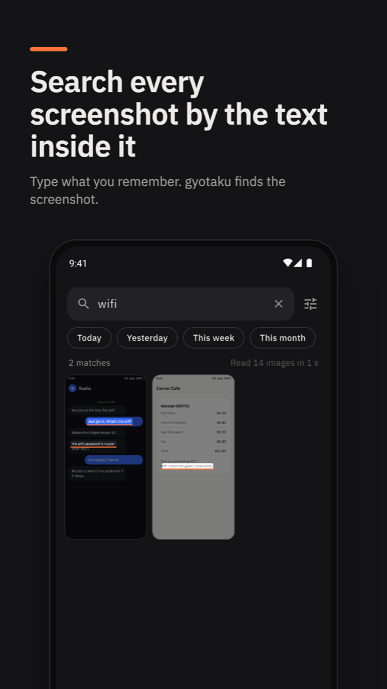
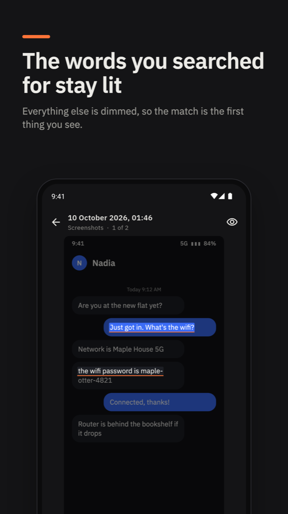
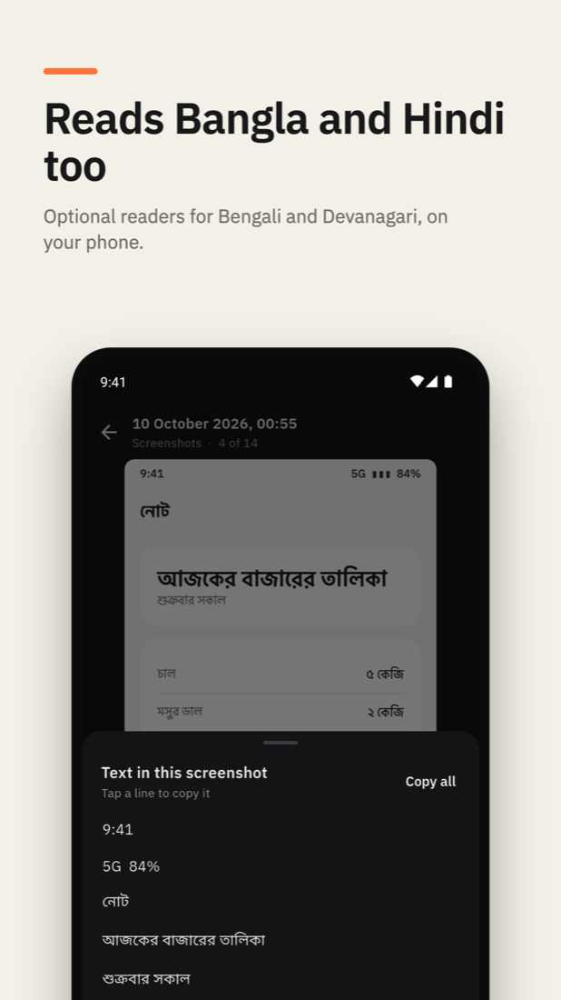
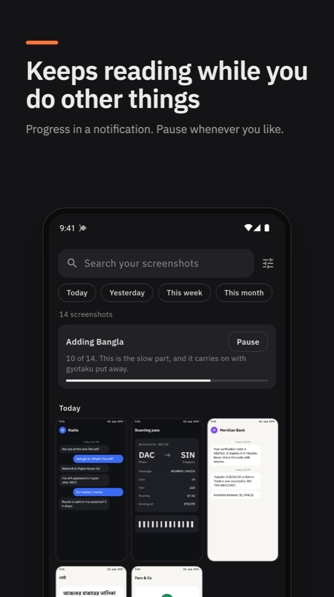

<p align="center">
  
</p>

# gyotaku for Android

Search every screenshot on your phone by the text inside it. Everything is read on the phone; nothing is uploaded.

<p align="center">
  
  
  
  
</p>

**This is an unofficial community app.** It is built on [gyotaku](https://github.com/xevrion/gyotaku), the desktop app by Yash Bavadiya, and uses that project's own index, search and readers. It is maintained here, separately, by Zaman Sheikh. Please report problems with the Android app in [this repository's issues](https://github.com/zamansheikh/gyotaku-android/issues), not to the desktop project.

Download the latest build from [Releases](https://github.com/zamansheikh/gyotaku-android/releases). Android 7.0 or later.

## What it does

- Finds screenshots by any part of a word in them, and lights up the lines that matched.
- Copies a screenshot's text, one line or all of it, and shares the image.
- Filters by Today, Yesterday, This week and This month.
- Lets you choose which folders are read. Screenshot folders are on to begin with.
- Optionally reads Bangla and Devanagari (Hindi, Marathi, Nepali) with readers that download once.
- Keeps reading with the app put away, with progress in a notification, and can be paused.

No account, no ads, no analytics. The only network use is downloading a reader you turn on.

## How it works

The phone reads its screenshots with the system's own text recognition (ML Kit) and hands the lines to `gyotaku-core`, which stores and searches them exactly as it does on the desktop.

ML Kit reads no Bangla or Devanagari, so reading is in two passes. The first is ML Kit alone, about a quarter of a second an image, which makes a whole library searchable in minutes. The second only happens while one of those scripts is turned on in settings: each image is gone over again by `gyotaku-ocr`, on the ONNX Runtime that ships inside the app, but only for the lines ML Kit was not sure of (`Ocr::read_rest`). That pass takes seconds an image.

Reading carries on with the app put away, in a foreground service (`android/app/src/main/kotlin/com/silifton/gyotaku/ScanService.kt`). The app runs in one Flutter engine that outlives its window (`MainActivity.kt`), so swiping it out of the recent apps list does not stop the reading.

## Layout

| Path | Contents |
|---|---|
| `lib/` | The Flutter app: the reader, the search grid, the open screenshot, settings |
| `lib/src/rust/` | Generated bindings. Do not edit |
| `rust/` | The bridge crate over `gyotaku-core` and `gyotaku-ocr` |
| `rust_builder/` | Generated build glue that compiles `rust/` for each platform |
| `store/play/` | Play Store listing, graphics and form answers |

`rust/Cargo.toml` takes the two gyotaku crates by git, pinned to a commit. For now that is a commit of a fork carrying the Bengali reader and `read_rest`, both proposed upstream (xevrion/gyotaku#8 and #10). Once they are merged it will point at xevrion/gyotaku.

## Building

Needs Flutter, the Android NDK, Rust (installed with rustup) and `cargo install flutter_rust_bridge_codegen`.

```sh
flutter run                              # on a connected device or emulator
flutter analyze
(cd rust && cargo test)                  # the bridge, on the host
flutter_rust_bridge_codegen generate     # after changing rust/src/api
flutter build apk --release --split-per-abi
```

A release build is signed with the key named in `android/key.properties` (`storeFile`, `storePassword`, `keyAlias`, `keyPassword`) when that file exists, and with the debug key otherwise. The file is never committed.

## Android versions

The first run (the app's own explanation, the system's prompt, Allow, then a first read) was gone through on emulators of each of these, with a release build:

| Android | What lets the app see images |
|---|---|
| 9 (API 28) | `READ_EXTERNAL_STORAGE` |
| 10 (API 29) | `READ_EXTERNAL_STORAGE`, with `requestLegacyExternalStorage` so files are read in place |
| 13 (API 33) | `READ_MEDIA_IMAGES` |
| 17 (API 37) | `READ_MEDIA_IMAGES`, or `READ_MEDIA_VISUAL_USER_SELECTED` for a chosen few |

Not run: 7 and 8 (API 24 to 27), 11 and 12, 14 to 16, and "Allow limited access" on 14 and later.

Three things each broke one of those and are easy to undo by accident:

- The app asks for images only (`photoAccess` in `lib/folders.dart`). The plugin's default also asks for videos, which Android 13 refuses outright when the manifest does not declare it.
- Listing a folder names a sort order. Without one the plugin's query is invalid on Android 10.
- After asking, the permission is checked again rather than trusting the answer. On Android 9 and earlier the plugin also asks to write, which is refused, and it then reports the whole request as refused.

## Measured

Pixel 6, Android 17, release build, the phone in use at the time:

| | Time |
|---|---|
| First pass, 1,752 images | 6 min 37 s (0.23 s an image) |
| Second pass with Bengali and Devanagari on, 2,243 images | about 2 h 48 min, estimated by the app from its first 20 |
| Reading everything with `crates/ocr` and both scripts, as before the two passes | 9.7 s an image, the mean of 8 screenshots |
| The same 8 screenshots, ML Kit and then `read_rest` | 8.2 s an image |

With the second version of the Bengali model, on the same phone and library, by the app's own count over a minute or two at a time (the images differ, so these are rough):

| | An image |
|---|---|
| Second pass, app on screen | 2.6 to 6 s |
| Second pass, app put away, reading threads left where the system put them | about 19 s |
| Second pass, app put away, reading threads kept to the faster cores | about 9 s |

Put away, the system allows the app six of the phone's eight cores, four of them the small ones. A recognizer waits for its slowest thread, so the reader is kept to the faster cores it is still allowed.

Several ML Kit readers at once are not used: on the same phone 2, 3, 4 and 6 at once took as long as one (10.2 to 11.5 s against 11.7 s for 60 images) and returned 417, 234, 255 and 103 lines where one returned 1,004.

## Not done

- iOS. The project is scaffolded and has never been built. The index keys a screenshot by file path, which the iOS photo library does not provide.
- With only Read Bengali on, Hindi text is read as Bangla. With both scripts on, each screenshot is read as whichever script most of its lines are in.
- The light theme, the refused permission screen, pull to refresh, loading more than 120 results and zooming have not been checked closely on a device.
- Whether the date filters use the phone's timezone.
- Grouping of near-identical screenshots, moving to the trash, and the rest of the desktop app's settings.

## Credits and license

gyotaku was created by [Yash Bavadiya](https://github.com/xevrion). The name and the fish mark are that project's. Its author asked that the Android app live in its own repository under its own package name, marked as unofficial, and offered to link it as a community app. The icon files in this repository are drawn from `assets/icon.svg` in xevrion/gyotaku. The icon is a fish drawn in lines of text, the way a screenshot holds them, with the one line the search found in vermilion. The screenshots above show invented content, not anyone's real messages or receipts.

Text recognition: ML Kit, PaddleOCR PP-OCRv6 and PP-OCRv5 models, and EasyOCR's Bengali model, run on ONNX Runtime. Typeface: IBM Plex Sans, under the SIL Open Font License 1.1 (`fonts/OFL.txt`).

Licensed under the [GNU General Public License v3.0 or later](LICENSE), like gyotaku itself.
